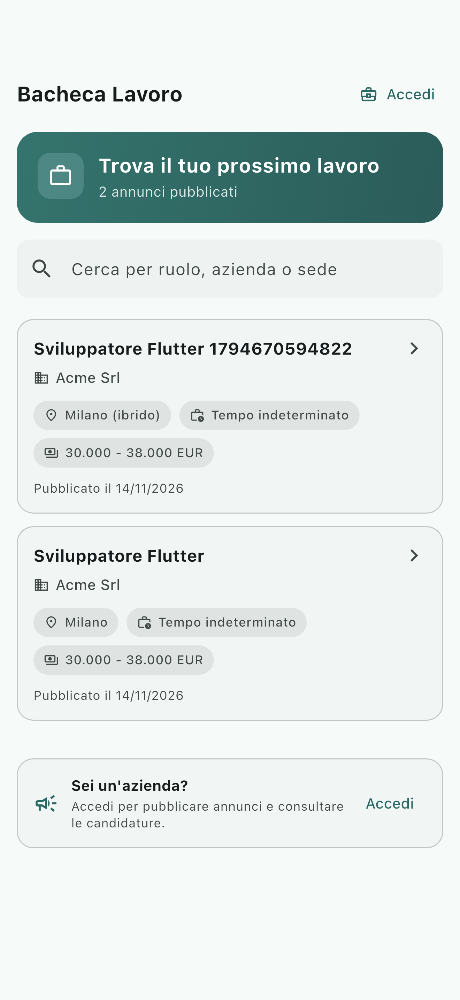
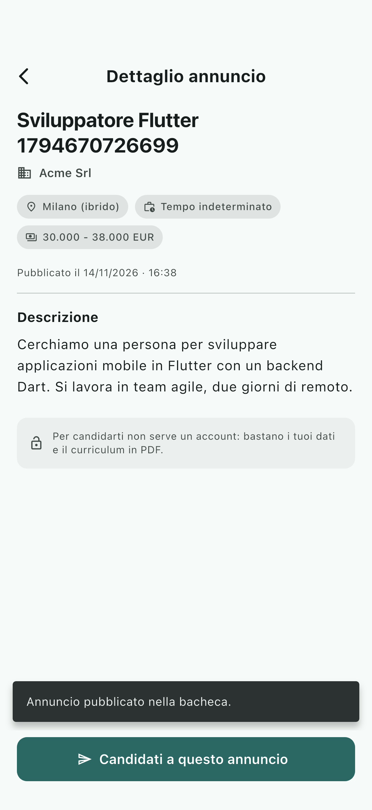
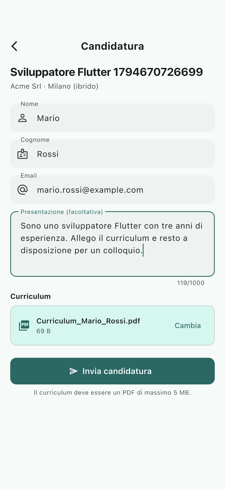
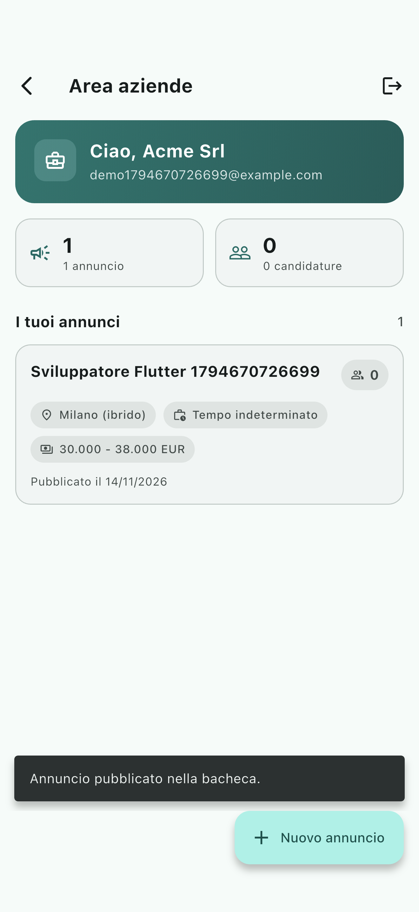
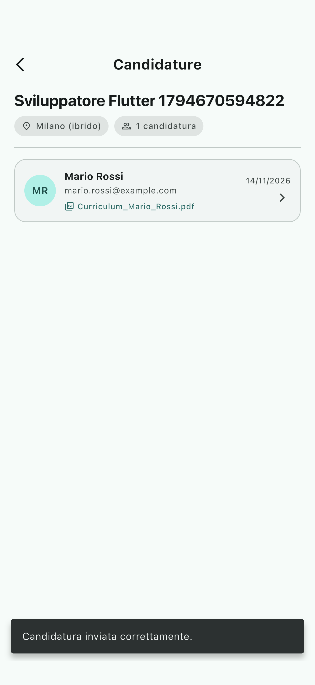
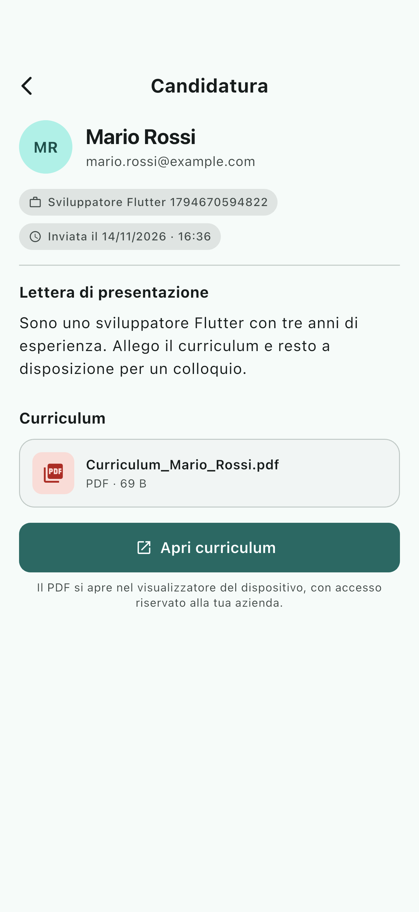

# Bacheca Lavoro — app Flutter

Client mobile della bacheca di annunci di lavoro: le **aziende** si registrano, accedono,
pubblicano annunci e consultano le candidature ricevute; i **candidati** navigano la
bacheca senza account e inviano la propria candidatura con il curriculum in PDF.

Il backend è un progetto separato (**bacheca-lavoro-server**, Dart + shelf) da avviare
sullo stesso computer. L'app parla solo con le sue API REST: niente Firebase o Supabase.

## Requisiti

- Flutter 3.27+ (testato con Flutter 3.47.7 / Dart 3.13.5)
- Backend avviato (vedi README del server: `dart run bin/server.dart`)
- Per iOS/macOS: Xcode con i simulatori; per Android: emulatore o telefono

## Configurazione dell'indirizzo del server

L'indirizzo è in [`lib/config/api_config.dart`](lib/config/api_config.dart) e il valore
predefinito (`http://127.0.0.1:8080`) va bene per simulatore iOS, app macOS e browser.

Per gli altri casi si passa `--dart-define` senza toccare il codice:

```bash
# emulatore Android (10.0.2.2 = "il computer che ospita l'emulatore")
flutter run --dart-define=API_BASE_URL=http://10.0.2.2:8080

# telefono reale sullo stesso Wi-Fi (usare l'IP stampato dal server)
flutter run --dart-define=API_BASE_URL=http://192.168.1.9:8080
```

## Avvio

```bash
flutter pub get
flutter run -d macos                          # oppure -d <id del simulatore/emulatore>
flutter devices                               # elenco dei dispositivi disponibili
```

Il progetto include le cartelle `ios/`, `android/` e `macos/`; la versione macOS serve
solo per provare l'app comodamente dal computer, il target è lo smartphone.

## Prova su iPhone reale

Serve un Apple ID (anche gratuito) per firmare l'app, e iPhone + Mac sulla stessa Wi-Fi.

1. iPhone: **Impostazioni → Privacy e sicurezza → Modalità sviluppatore** → attiva e riavvia;
   collegare l'iPhone al Mac e rispondere *Consenti* a "Fidati di questo computer".
2. Xcode → **Settings → Accounts → +** con il proprio Apple ID → *Manage Certificates…* →
   **+ → Apple Development** (crea il certificato di sviluppo).
3. Nel progetto: aprire `ios/Runner.xcworkspace` in Xcode → target **Runner** →
   *Signing & Capabilities* → spuntare *Automatically manage signing* e scegliere il proprio
   **Team**; se l'identificativo è già usato da un altro account, cambiarlo
   (es. `it.cognome.bachecaLavoro`).
4. Avvio sulla rete locale, con l'IP del Mac (`ipconfig getifaddr en0`):

   ```bash
   cd app
   flutter run -d <id-iphone> --dart-define=API_BASE_URL=http://192.168.1.9:8080
   ```

5. Al primo avvio iOS mostra *"consentire all'app di trovare e connettersi a dispositivi
   sulla rete locale?"*: rispondere **Consenti** (la descrizione è in `Info.plist`, chiave
   `NSLocalNetworkUsageDescription`). Senza questo permesso l'app non raggiunge il server.
6. Con un Apple ID gratuito la firma scade dopo **7 giorni**: per riprovare basta rilanciare
   `flutter run` dal Mac.

Se la connessione non parte: verificare da Safari sull'iPhone che
`http://192.168.1.9:8080/api/health` risponda, che il Mac non vada in stop (il server si
ferma) e che la Wi-Fi non sia una rete "ospiti" con isolamento dei client.

## Gli scenari del compito

### S1 — Pubblicare un annuncio (R1, R2, R4)

1. Bacheca → in alto a destra **Accedi** → *Non hai un account? Registra la tua azienda*.
2. Compilare nome, email e password (almeno 8 caratteri con lettere e numeri) → **Crea
   account**. L'account viene creato e la sessione è già attiva.
3. Nell'area aziende toccare **Nuovo annuncio**, compilare titolo, sede, tipo di contratto,
   retribuzione (facoltativa) e descrizione → **Pubblica annuncio**.
4. L'annuncio compare subito in cima alla bacheca pubblica; il pulsante **Esci** in alto a
   destra chiude la sessione e riporta alla bacheca.

### S2 — Candidarsi a un annuncio (R5, R6)

1. All'apertura l'app mostra la bacheca con gli annunci (ricerca per ruolo, azienda o sede).
2. Toccare un annuncio per il dettaglio (azienda, sede, contratto, retribuzione, descrizione).
3. **Candidati a questo annuncio** → compilare nome, cognome, email e presentazione,
   **Scegli file** per allegare il curriculum PDF (max 5 MB) → **Invia candidatura**.
4. Compare la conferma e la candidatura è già salvata sul server.

### S3 — Consultare le candidature e uscire (R7, R3)

1. **Accedi** con l'account dell'azienda → l'area riservata elenca i propri annunci con il
   numero di candidature ricevute.
2. Toccare un annuncio → elenco dei candidati (nome, email, curriculum, data).
3. Toccare un candidato → dati completi, lettera di presentazione e **Apri curriculum**
   (il PDF si apre nel visualizzatore del dispositivo).
4. **Esci** → si torna alla bacheca pubblica; le rotte riservate richiedono di nuovo il login.

## Screenshot

Schermate reali catturate dall'app in esecuzione su simulatore iOS durante il test
end-to-end (`integration_test/app_flow_test.dart`), contro il backend vero.

| Bacheca | Dettaglio | Candidatura |
| --- | --- | --- |
|  |  |  |

| Area aziende | Candidature ricevute | Dettaglio candidato |
| --- | --- | --- |
|  |  |  |

Altre immagini in [`docs/screenshots/`](docs/screenshots): registrazione, form annuncio,
conferma di invio, ritorno alla bacheca dopo il logout.

## Test

```bash
flutter analyze     # nessun warning
flutter test        # 4 test di interfaccia (client HTTP simulato)
```

I test in `test/widget_test.dart` verificano: bacheca popolata dal server, gestione
dell'errore di rete con "Riprova", messaggio di errore del login, e il flusso di
candidatura completo (blocco senza curriculum, allega PDF, invio multipart, conferma).

Test end-to-end sui tre scenari, con app vera e backend vero (14 screenshot salvati):

```bash
# con il server avviato
flutter drive --driver=test_driver/integration_test.dart \
  --target=integration_test/app_flow_test.dart -d <device-id>
```

Il test registra un'azienda, pubblica un annuncio, esce, si candida allegando un PDF,
verifica che il PDF sia scaricabile solo dall'azienda proprietaria, consulta le candidature
e fa logout. L'unico pezzo simulato è la scelta del file: il selettore nativo di sistema
non è automatizzabile, quindi il test inietta un `CvPicker` finto (l'upload verso il server
è quello reale). Il selettore nativo è stato verificato a mano: si apre il pannello
"File" di iOS filtrato sui PDF.

## Struttura

```
lib/main.dart                 app, provider (ApiClient, AuthProvider, CvPicker), tema
lib/config/api_config.dart    indirizzo del backend e timeout
lib/routes.dart               rotte nominali + guardia sull'area riservata
lib/models/                   Company, Job, Application
lib/providers/                AuthProvider: login, registrazione, sessione persistente
lib/services/api_client.dart  chiamate REST, upload multipart, gestione errori
lib/services/cv_picker.dart   astrazione sul selettore PDF (sostituibile nei test)
lib/screens/                  bacheca, dettaglio, candidatura, login, registrazione,
                              area aziende, form annuncio, candidature, dettaglio candidato
lib/widgets/                  componenti condivisi (card annuncio, header, stati vuoti/errore)
integration_test/             test end-to-end degli scenari
test/                         test di interfaccia
```

## Scelte tecniche e limiti noti

- **Stato**: `provider` + `ChangeNotifier`; il token è salvato con `shared_preferences`,
  così la sessione dell'azienda sopravvive alla chiusura dell'app e viene validata con
  `/api/auth/me` all'avvio.
- **Ruoli**: il client distingue solo area pubblica e area aziende; il controllo vero
  (proprietà degli annunci, accesso ai curriculum) è sul server, che risponde 401/403.
- **Curriculum**: si apre nel visualizzatore PDF di sistema tramite `url_launcher`, con un
  URL che porta il token come parametro (il browser non può inviare l'header `Authorization`).
- **HTTP in chiaro**: il backend di un progetto didattico gira in HTTP sulla rete locale,
  quindi `ios/Runner/Info.plist` contiene un'eccezione App Transport Security e Android ha
  `usesCleartextTraffic`. In produzione servirebbe HTTPS e queste eccezioni andrebbero tolte.
- **Nessuna cache offline**: ogni schermata legge dal server; senza rete l'app mostra un
  messaggio con "Riprova" (i dati restano comunque persistenti sul server, non nel client).
- **Nessuna build Android verificata in questo ambiente**: manca l'Android SDK sulla macchina
  di sviluppo; il progetto Android è presente e configurato (permesso INTERNET, cleartext),
  ma la verifica è stata fatta su simulatore iOS e app macOS.
